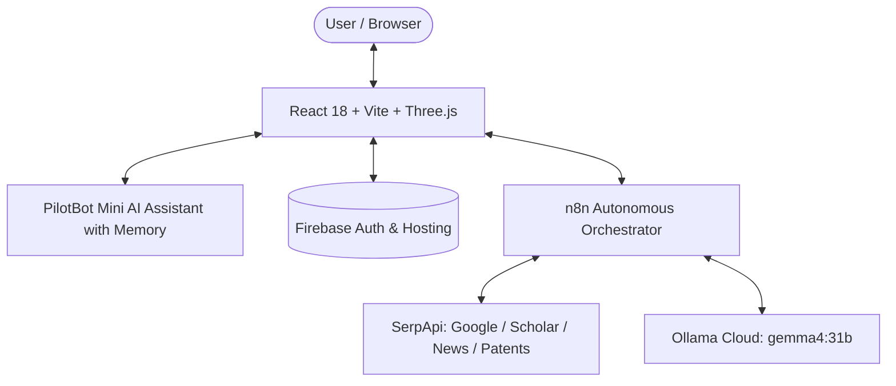

# ResearchPilot — Autonomous AI Research Intelligence Platform 🚀

[](https://researchpilot-d6b95.web.app)
[](https://vitejs.dev/)
[](https://react.dev/)
[](https://threejs.org/)
[](https://n8n.io/)
[](https://ollama.com/)

**ResearchPilot** is an autonomous multi-agent research intelligence platform designed for the **SerpApi India Hackathon 2026 (Track 5: Knowledge & Public Interest)**. It turns complex research inquiries into evidence-backed scientific intelligence dossiers, multi-dimensional comparative matrices, fact-checked citation graphs, and actionable experimental directions in plain, simple English.

---

## 🌟 Key Features

### 1. 🤖 Mini AI Chatbot with Persistent Memory (PilotBot)
* **Powered by Ollama Cloud:** Integrated with Ollama key (`gemma4:31b`) and intelligent contextual responder.
* **Conversational Memory:** Remembers all past user questions, conversation context, and user preferences across turns.
* **Persistent Storage:** Chat history is automatically stored in `localStorage`, persisting across page refreshes and browser sessions.
* **Everyday Simple English:** Answers are structured in friendly, easy-to-read everyday words (no complex academic or AI jargon).
* **Interactive Controls:** Floating pulse widget, quick prompt suggestions, copy-to-clipboard, export chat history (`.txt`), and clear memory controls.

### 2. 🔍 Multi-Engine Autonomous Search
* **Engines Supported:** Google Search, Google Scholar, Google News, and Google Patents via SerpApi.
* **Autonomous Pipeline:** Auto-generates engine-tailored queries, extracts titles, abstracts, snippets, citation counts, and patent IDs.
* **Deduplication & Grounding:** Deduplicates across sources and enforces strict citation tokens (`[S001]`, `[D001]`).

### 3. 📂 Document Intelligence (Up to 50 Files)
* Upload up to **50 documents, research papers, notes, or PDFs**.
* Extracts key excerpts, creates document tokens (`[D001]`, `[D002]`), and cross-verifies web findings against your uploaded files.

### 4. 🌐 Interactive 3D Visuals & Welcome Dashboard
* **Three.js Particle Galaxy:** Smooth ambient 3D particle constellation responding to mouse movement.
* **Mission Control Dashboard:** Overview cards explaining each step in plain English, with quick preset buttons for India public health and clean energy.

### 5. 🔐 Firebase Authentication & Workspace History
* **User Authentication:** Firebase Auth with persistent login sessions.
* **My Saved Searches Workspace:** Automatically saves completed dossiers and searches for quick one-click retrieval.

---

## 🏗️ Architecture & Technology Stack



* **Frontend:** React 18, Vite, Tailwind CSS, Lucide Icons, Three.js
* **Hosting:** Firebase Hosting ([https://researchpilot-d6b95.web.app](https://researchpilot-d6b95.web.app))
* **Auth:** Firebase Authentication
* **Backend:** n8n Workflow Automation (`https://15.252.236.234.sslip.io`)
* **AI/LLM:** Ollama Cloud (`gemma4:31b`)
* **Search:** SerpApi Multi-Engine Search

---

## 🚀 Quick Start Guide

### Prerequisites
* Node.js 18+
* npm or bun

### 1. Clone the repository
```bash
git clone https://github.com/jwalithc-png/ResearchPilot.git
cd ResearchPilot
```

### 2. Install dependencies
```bash
npm install
```

### 3. Run development server
```bash
npm run dev
```

Open `http://localhost:5173` in your browser.

### 4. Build for production
```bash
npm run build
```

### 5. Deploy to Firebase Hosting
```bash
firebase deploy --only hosting
```

---

## 📄 License
MIT License. Built for SerpApi India Hackathon 2026.
